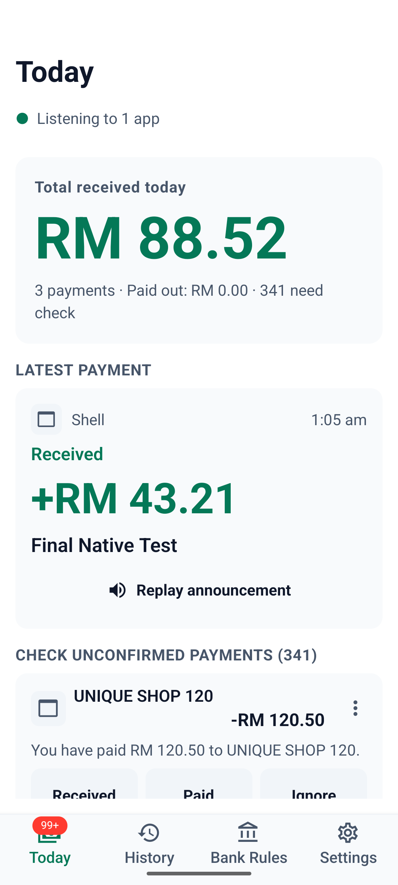
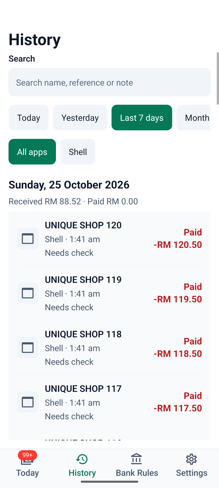
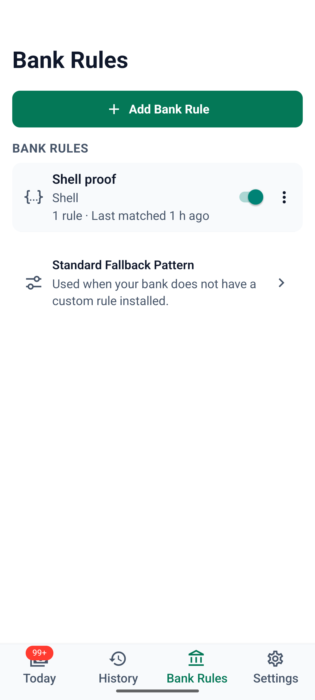

# PayPing Lite

Free, open-source payment tracking for Malaysian banks and e-wallets. PayPing Lite reads payment alerts, logs them, and can announce them aloud—entirely on your phone, with no account, backend, analytics, or network calls.

- **Android:** native notification listener for apps you select.
- **iOS 27:** Shortcuts automations pass notifications to the native App Intent.
- **Licence:** [GPL-3.0-or-later](LICENSE).

| Today | History | Bank Rules |
| --- | --- | --- |
|  |  |  |

More screenshots, including Malay and large-text layouts, are in [`design/screens/`](design/screens/).

## Build

Install JavaScript dependencies with `npm install`. A development build is required; Expo Go does not include PayPing's native capture module.

### Local Android

With an Android SDK, JDK, and connected device or emulator:

```bash
npx expo run:android --variant release
```

To build an APK without installing it:

```bash
./android/gradlew -p android :app:assembleRelease
```

The APK is written to `android/app/build/outputs/apk/release/app-release.apk`.

### EAS

```bash
npx eas-cli@latest build --profile production --platform android
npx eas-cli@latest build --profile production --platform ios
```

Use `--profile development` or `--profile preview` for the other build configurations in `eas.json`.

## Test

```bash
npm test
npx tsc --noEmit
npx expo lint
./android/gradlew -p android :payping-capture:testDebugUnitTest
```

Swift engine tests on Linux:

```bash
cd modules/payping-capture/ios/Engine
~/.local/swift/bin/swift test --build-system native
```

Android Maestro end-to-end tests, with a running emulator:

```bash
ANDROID_SERIAL=emulator-5554 scripts/e2e.sh
```

See [`e2e/README.md`](e2e/README.md) for flow details and syntax checks.

## Project layout

- [`src/app/`](src/app/) — Expo Router screens.
- [`src/components/`](src/components/), [`src/db/`](src/db/), [`src/parser/`](src/parser/) — UI, typed database access, and TypeScript rule engine.
- [`modules/payping-capture/`](modules/payping-capture/) — Kotlin and Swift capture, storage, parsing, and speech.
- [`parser-library/`](parser-library/) — user-importable parsers, fixtures, and schema; not bundled into the app.
- [`design/`](design/) — UX specifications and screenshots.
- [`e2e/`](e2e/) — Maestro flows and test notifier.
- [`site/`](site/) — parser website source.
- [`store/`](store/) — store listings, privacy documents, and release notes.

See [`PLAN.md`](PLAN.md) for scope, architecture, database ownership, and parser rules.
