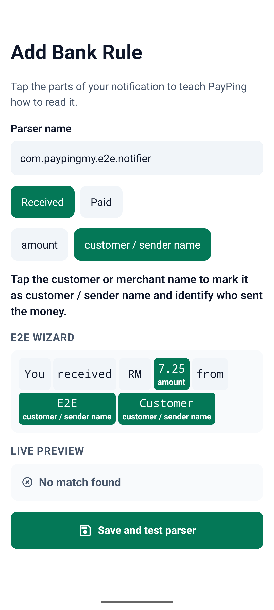

# Android E2E findings

Tested on `pixel36qa` (`emulator-5554`) with the x86_64 release APK built from main commit `4fd72db` plus these E2E changes. No application source files were changed.

## Wizard preview does not match the notification used to create it

**Flow:** `05-wizard.yaml` — fails at `assertVisible: "Match found"`.

**Reproduction:**

1. Complete onboarding and select **E2E Notifier** for capture.
2. Post a real notification from the test app:
   ```bash
   adb -s emulator-5554 shell "am start -W -n com.paypingmy.e2e.notifier/.MainActivity --es title 'E2E Wizard' --es tag 'e2e-3' --es body 'You received RM 7.25 from E2E Customer'"
   ```
3. On Today, under **CHECK UNCONFIRMED PAYMENTS (1)**, tap **Payment check actions** → **Teach PayPing this format**.
4. Tap token `7.25` as the amount, then tokens `E2E` and `Customer` as the customer / sender name.
5. Scroll to **Live preview**.

**Expected:** The generated parser matches its source notification and shows **Match found**. Saving and re-parsing should make the capture high confidence.

**Actual:** All three tokens are selected, but Live preview shows **No match found**. The flow stops here, so save/re-parse and the high-confidence assertions do not execute.


